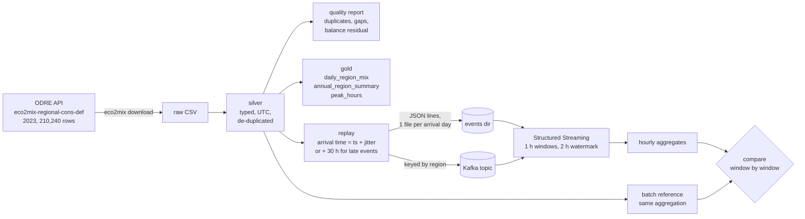

# eco2mix-spark-pipeline

[](https://github.com/Adversitas/eco2mix-spark-pipeline/actions/workflows/ci.yml)
[](https://github.com/Adversitas/eco2mix-spark-pipeline/actions/workflows/pipeline.yml)

**A PySpark batch and Structured Streaming pipeline on RTE's eco2mix data: consumption, production by source and exchanges for every French region, every half-hour of 2023 (210,240 records).**

- **Batch**: raw CSV → typed, de-duplicated silver layer → quality report → gold tables (daily energy mix per region, annual summary, peak half-hours via window functions), written as partitioned Parquet.
- **Streaming**: the same real records replayed as JSON events (to Kafka, or to files for tests and CI), out of order and with injected late data; Spark Structured Streaming computes hourly regional aggregates with a watermark.
- **Verification**: the streaming output is joined back to the batch result, window by window, and every disagreement is counted and explained.
- **CI**: unit tests on a real sample, plus a workflow that downloads the full year and runs the whole pipeline on every change ([pipeline.yml](.github/workflows/pipeline.yml)).

> **En bref (FR)** : pipeline PySpark batch et streaming sur les données éCO2mix de RTE (consommation, production par filière et échanges de chaque région, à la demi-heure, 2023 : 210 240 enregistrements). Le batch produit une couche silver typée et dédoublonnée, un rapport qualité, des tables gold (mix énergétique quotidien, synthèse annuelle, pointes de consommation par fonctions de fenêtrage) en Parquet partitionné. Le streaming rejoue les vrais enregistrements sous forme d'événements JSON (Kafka ou fichiers), désordonnés et avec des retards injectés ; Spark Structured Streaming calcule des agrégats horaires avec watermark. Chaque fenêtre du flux est comparée au résultat batch. Le contrôle qualité a révélé un artefact de changement d'heure dans les données publiées, et la mesure a montré que le watermark de Spark tolère en pratique un micro-batch de retard de plus que sa valeur nominale.

## Results

All figures come from the full 2023 run in GitHub Actions (`ubuntu-latest`, 4 vCPU, Spark 3.5.3 `local[*]`); see the job summary of the [Pipeline workflow](https://github.com/Adversitas/eco2mix-spark-pipeline/actions/workflows/pipeline.yml). The batch figures are identical on a Windows laptop.

### Batch and data quality

| | |
|---|---:|
| Raw records | 210,240 |
| Silver records (after de-duplication) | 210,216 |
| Regions × half-hours expected | 12 × 17,520 |
| Duplicate rows (all identical copies) | 24 (2 per region) |
| Missing half-hours | 24 (2 per region) |
| Null or negative production values | 0 |
| Regional balance residual, median / p99 / max | 0.03 % / 1.7 % / 4.9 % of consumption |
| Batch job (read, silver, quality, gold) | 14 s |

**A daylight-saving artefact in the published data.** The 24 duplicates and the 24 gaps are the same phenomenon. The series is published on a grid of 48 local half-hours per day, every day:

- on 26 March 2023 (clocks go forward), the local slots 02:00 and 02:30 do not exist, but rows are published for them anyway, with the same UTC timestamp and the same values as 03:00 and 03:30, hence 2 identical duplicates per region;
- on 29 October 2023 (clocks go back), the local hour 02:00-03:00 happens twice, but only one set of rows is published, so 2 UTC half-hours are missing per region.

The silver layer keys on the UTC timestamp, so the duplicates collapse (the report checks they are identical copies, not conflicting values) and the October gap is reported, not invented. A pipeline keyed on the local `date` + `heure` columns would double-count March and never notice October.

**The balance check.** For each region and half-hour, consumption should equal production + pumping + net physical exchanges. The median residual is 0.03 % of consumption; the worst is 4.9 %. That is the level of consistency to expect from the published figures, and a threshold for alerting on future loads.

### Annual summary (gold table)

| Region | Consumption TWh | Production TWh | Renewable share of production | Production / consumption | Peak MW |
|---|---:|---:|---:|---:|---:|
| Île-de-France | 63.21 | 3.57 | 54.3 % | 0.06 | 13,325 |
| Auvergne-Rhône-Alpes | 60.73 | 116.54 | 27.1 % | 1.92 | 11,673 |
| Hauts-de-France | 46.16 | 51.51 | 31.3 % | 1.12 | 8,627 |
| Nouvelle-Aquitaine | 40.92 | 52.86 | 28.4 % | 1.29 | 8,228 |
| Grand Est | 40.88 | 85.17 | 25.5 % | 2.08 | 7,816 |
| Provence-Alpes-Côte d'Azur | 38.65 | 17.47 | 72.9 % | 0.45 | 7,293 |
| Occitanie | 36.09 | 23.08 | 78.5 % | 0.64 | 7,914 |
| Normandie | 25.60 | 60.20 | 6.3 % | 2.35 | 5,473 |
| Pays de la Loire | 25.02 | 7.64 | 79.5 % | 0.31 | 5,503 |
| Bretagne | 21.41 | 6.85 | 61.5 % | 0.32 | 4,718 |
| Bourgogne-Franche-Comté | 19.55 | 5.42 | 88.5 % | 0.28 | 3,648 |
| Centre-Val de Loire | 17.31 | 62.42 | 8.6 % | 3.61 | 3,724 |

Every regional peak of 2023 fell between 23 January and 27 February, on winter weekday mornings (07:00-10:30 UTC) or evenings (18:00 UTC).

### Streaming vs batch

Hourly windows per region, 2-hour watermark, one file per arrival day (one micro-batch each), `availableNow` trigger.

| Replay | Events | Micro-batches | Throughput | Region-hours emitted | Windows matching batch exactly | Events dropped by Spark |
|---|---:|---:|---:|---:|---:|---:|
| Out of order (0-60 min), nothing late | 210,216 | 367 | 1,643 events/s | 105,072 of 105,108 | **105,072 / 105,072** | 0 |
| Same + 1 % of events 30 h late | 210,216 (2,088 late) | 368 | 1,549 events/s | 105,071 of 105,108 | 104,816 / 105,071 | 256 |

- **Nothing late: the stream reproduces the batch exactly.** Every emitted window has the same event count and the same energy figures. The 36 windows not emitted are the last 3 hours of each of the 12 regions: the watermark had not closed them when the replay ended, as append mode intends.
- **1 % late: Spark dropped 256 of the 2,088 late events and aggregated the others into their windows.** 255 emitted windows are short of events, and no window was emitted twice (a late row reopening a closed window would have produced a second, partial row). The streaming tests assert on the real sample that no window ever counts more events than really happened.
- **Why only 256?** A simple model ("the watermark of a batch is the latest event time seen before it, minus 2 hours") predicts 2,086 drops. Modelling the watermark as lagging two micro-batches predicts 253, against 256 measured. In this setup the watermark effectively tolerates one extra batch interval (here a day) of lateness beyond its nominal 2 hours. The simulation ships in [replay.py](src/eco2mix/replay.py), so the expected drop count is printed before every streaming run. It is an empirical model fitted to this run, not a reading of Spark's source.

The practical lessons: the watermark's real tolerance depends on the batch interval, so measure it instead of assuming it, and reconcile the stream against a batch recomputation before trusting it.

## Architecture



## How to run

Needs Java 17.

```bash
python -m venv .venv && source .venv/bin/activate   # Windows: .venv\Scripts\activate
pip install -e ".[dev,kafka]"

eco2mix download --year 2023                      # ~40 MB CSV from ODRE
eco2mix batch --out out                           # quality report, gold Parquet, summary
eco2mix replay --late-fraction 0.01               # events -> data/events
eco2mix stream --verify                           # streaming + comparison with batch

pytest -q && ruff check . && ruff format --check .
```

With Kafka (see [docker-compose.yml](docker-compose.yml)):

```bash
docker compose up -d
eco2mix replay --kafka localhost:9092
eco2mix stream --source kafka --kafka localhost:9092
```

The tests run on [tests/fixtures/eco2mix_sample.csv](tests/fixtures/eco2mix_sample.csv), 384 unmodified rows (Auvergne-Rhône-Alpes and Provence-Alpes-Côte d'Azur, 10-11 January and 20-21 June 2023). The batch tests run everywhere. The two streaming tests need Hadoop's local file system, which on Windows requires `winutils.exe`. They are skipped there and run in CI on Linux.

## Limitations

- Spark runs in `local[*]` mode: the code is cluster-ready (no driver-side collection in the transformations), but the throughput figures are for a single 4-vCPU runner and a file source, not a cluster.
- The Kafka path shares the parsing and windowing code with the file path and has a unit test for message decoding, but it is not exercised in CI (no broker there).
- Replaying a year as 368 daily micro-batches is a test of correctness, not of latency.
- The explanation of the 256 drops is an empirical model that matches the measurement within 3 events; it has not been checked against Spark's source code.
- Renewable share counts wind, solar, hydro and bioenergy as renewable; pumped storage is netted out of consumption, not counted as production.

## Data and license

eco2mix regional consolidated and definitive data, published by RTE on [ODRE](https://odre.opendatasoft.com/explore/dataset/eco2mix-regional-cons-def/) under the [Licence Ouverte 2.0](https://www.etalab.gouv.fr/licence-ouverte-open-licence/). Code: MIT, see [LICENSE](LICENSE).
